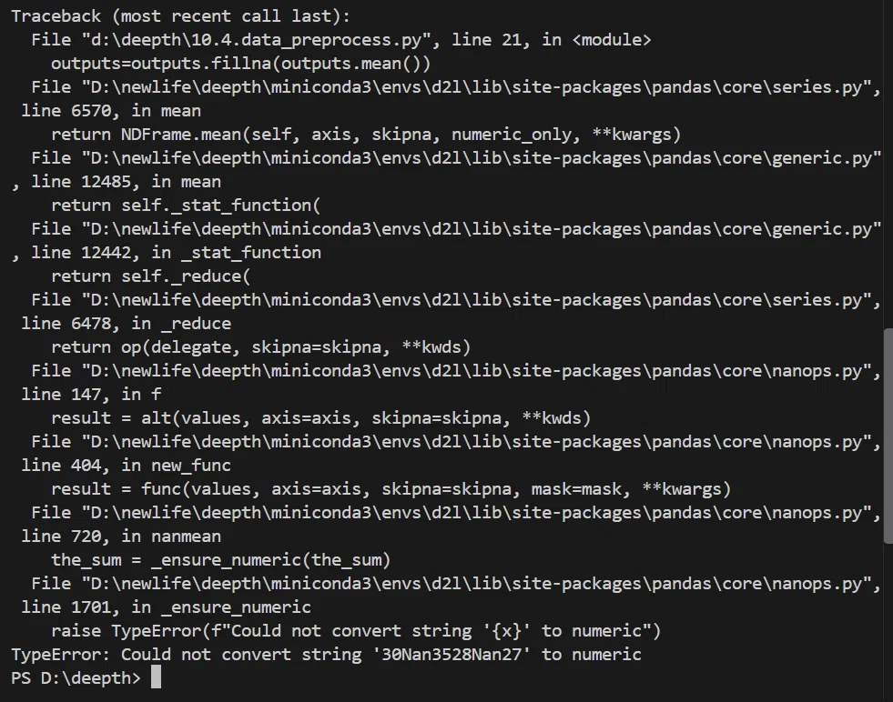
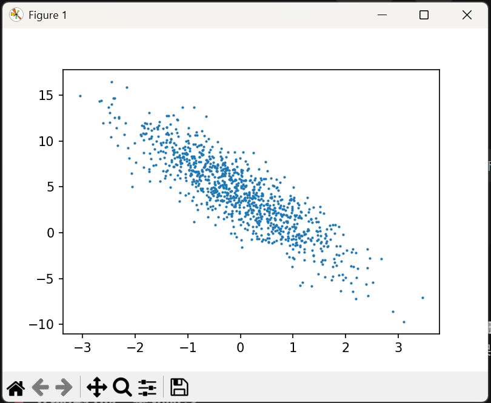
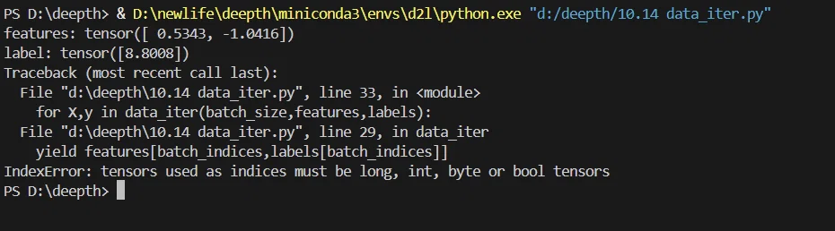
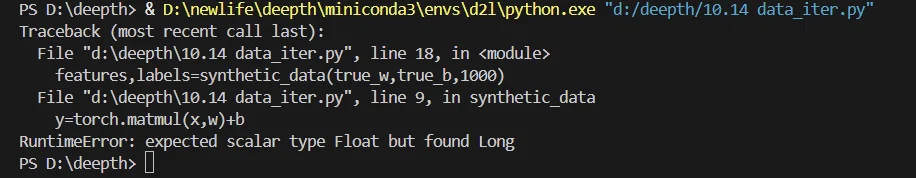

# 深度学习成长记录
本仓库为个人学习李沐老师的《动手学习深度学习》的学习记录，部分代码参考自李沐老师的开源教程 d2l.ai。
## Day1 (2026.9.24)
- 看完了b站上的课程，并学习了数据操作，简单了解了一下torch
## Day2 （2026.9.27）
- 复习了一些张量代码，并打算在vs中实现。
## Day3 (2026.9.28)
打了代码了，但是主要有三类问题
**1，广播机制报错**
必须是从最右边（最后一维）开始对齐
j = torch.arange(0, 12)  # 形状是 [12]
h = torch.reshape(j, [3, 4])  # 形状是 [3, 4]
print("广播：j+h:", j+h)
这一段代码 j 的形状是j[12]，h的形状是h[3,4]，最右侧12和4并不相等，并且12也并不为1，所以无法补全导致出错
* **总结：在二维张量中行和列至少有一个相等，不相等的那个需要为1。这样才能广播**

**2.在张量相加的时候需要长度相等**
x=torch.tensor([1,2,3,4,5])
y=torch.tensor([4,5,6,7,8,9])
before=id(y)
y=y+x
id(y)==before
* **长度不相等，导致无法相加。**

**3.m.item要打印需要加括号**

## Day4 (2026.9.30 - 2026.10.5) 数据预处理

### 核心目标
将现实世界中的“脏数据”（含缺失值、非数值特征），转换为深度学习模型能够处理的“干净张量”。

### 工具包
- `pandas`：用于数据清洗和特征工程。
- `torch`：用于将处理好的数据转换为张量。

### 操作步骤

#### 1. 生成并读取原始数据
- **生成数据**：
  - 使用 `os.makedirs(os.path.join('..', 'data'), exist_ok=True)` 创建文件夹。
  - 使用 `open()` 和 `f.write()` 将数据写入 `house_tiny.csv`。
- **读取数据**：
  - 使用 `pd.read_csv(data_file)` 加载 CSV，得到 DataFrame。

#### 2. 处理缺失值（两种核心方法）
- **方法一：删除法**
  - 直接忽略含缺失值的行或列（适合缺失极少的数据）。
- **方法二：插值法**（最常用，重难点）
  - **第一步：拆解数据**：使用 `iloc` 将数据拆分为输入（`inputs`）和输出（`outputs`）。
  - **第二步：分类处理**（这是最容易踩坑的地方）：
    - **数值列（如 `NumRooms`）**：使用均值填充。
    代码：`inputs['NumRooms'] = inputs['NumRooms'].fillna(inputs['NumRooms'].mean())`。
    - **非数值列（如 `Alley`）**：使用独热编码。
    代码：`inputs = pd.get_dummies(inputs, dummy_na=True)`。
  - **第三步：转换为张量**：`torch.tensor(inputs.values)`。

#### 3. 独热编码（One-Hot Encoding）深度理解
- **核心逻辑**：扫描整表 → 找出唯一值 → 拆列生成（出现为1，未出现为0）→ 删掉原列。
- **`dummy_na` 参数的作用**：
  - `dummy_na=True`：把缺失值（NaN）本身也当成一种特征类别，单独开一列。
  - `dummy_na=False`：把 NaN 当空气，缺失的行在新列里全为0。
- **学术总结**：适用于“无序的定性特征（Nominal Categorical）”、“离散型特征（Discrete）”、“输入特征（Input Features）”。
- **白话总结**：无序的，同级的，是特征。

###  代码深度解析与避坑

#### 1. `os.makedirs(os.path.join('..', 'data'), exist_ok=True)`
- `os.path.join`：纯字符串拼接函数，用当前操作系统的路径分隔符连接参数。
- `os.makedirs`：系统 API 调用，尝试在硬盘上创建目录。
- `exist_ok=True`：关键字参数。若目录已存在，则静默跳过，不抛出 `FileExistsError`。
- **执行本质**：调用了系统 API，产生了物理副作用（创建了文件夹）。

### 4.inputs = pd.get_dummies(inputs, dummy_na=True)
- 1.扫描全表，检查数据类型
- 2.找出选项:针对符合独热代码条件的那一项，pandas会手机里面所有出现过的不重复的值。
- 3.拆列:生成新列，出现几个值就出现几个列，对比每列所代表的值，是这个值输入1，不是这个值则输入e。然后把原来的列直接删掉
- 4.括号中多出来的参数的作用:
    dummy_na=True:让缺失值本身也是一种特征类别
    dummy_na=False:把NaN当作空气直接五列。让缺失的那一行正在新列上都是e。
- 5.重新赋值:把做完变动的新表格覆盖原来的变量

#### 3. `pd.get_dummies()` 的传入陷阱
- **错误写法**：`inputs = pd.get_dummies(inputs['Alley'], dummy_na=True)`
  - **后果**：只取了 `Alley` 这一列，处理完赋值给 `inputs` 时，**会把原来的 `NumRooms` 列直接覆盖丢掉！**
- **正确写法**：`inputs = pd.get_dummies(inputs, dummy_na=True)`
  - **解释**：传入整个表，pandas 会自动扫描：数值列原封不动保留，文本列自动做独热编码。
- **如果需要单独处理某列并拼接**：
  ```python
  temp_alley = pd.get_dummies(inputs['Alley'], dummy_na=True)
  inputs = pd.concat([inputs['NumRooms'], temp_alley], axis=1)

### 报错处理
- ：NAN的拼写错误，拼写成为Nan。
  - 解决一：将拼写改正为NaN。
  - 解决二：`data = pd.read_csv(data_file, na_values=['Nan'])`
- 没有删除缺失值最多的列：
  `most_missing=data.isnull().sum().idxmax()`
  `data=data.drop(columns=[most_missing])`  
  **分析**
  `data.isnull`：检查表格里的每个格子是不是空的，若是空的则标为True，否则为False.
  `.sum`：对上一步的True（1）和False（0）表格求和。
  `idxmax`：找出最大值对应的索引（列名）
  `data.drop`：用来删除的函数
  `columns=[most_missing]`：要删除东西的列表

## Day5（2026.10.5-2026.10.9）线性代数
### 概念理解
- **标量**：函数中的确定值
- **向量**：
1.标量值组成的列表，这些标量值被称为向量的元素，或分量。
2.可以根据数据库中的表类推，表的“一行”是一个“样本向量”，“一列”是一个“特征向量”。 向量里的每一个分量，就是数据库里最基础的数据单元。
3.人们通过一维张量表示向量。一般来说，张量可以具有任意长度，取决于机器的内存限制
- **长度，维度和形状**
  - **长度**：向量的长度通常称为向量的维度。
  Python的内置len()函数来[访问张量的长度]。
  返回该张量第0维的元素数量，也就是只关心有多少行
  当用张量表示一个向量（只有一个轴）时，我们也可以通过.shape属性访问向量的长度。
  - **维度**：张量维度=轴的数量，某个向量或轴的长度=轴上元素的数量
- **矩阵**：将向量从一阶推广到二阶。
  - 表示：
  - 转置：交换行和列
- **张量**：是描述具有任意数量轴的n维数组的通用方法。
  - 张量计算的基本性质：
  1.一元运算（只对一个张量做操作，比如求绝对值，求平方，求指数）不改变形状。给定具有相同形状的任意两个张量，任何按元素二元运算结果都将是相同的形状和张量。
  2.加和乘都不会改变张量的形状。
- **降维**：
  - 调用求和函数会沿所有的轴降低张量的维度，使它变为一个标量。
  **白话**把某一个方向的数全部加起来，然后把那个方向消灭掉
  sum可以求任意形状张量的元素和

## Day6 线性回归的从零开始实现——生成数据集（10.9-10.13）
### 概念理解：
- **回归**：经常表示输入和输出之间的关系。
- **线性模型**：y=kx+b，k为权重，b为截距，偏置。
**对于一个给定的数据集，我们需要找到其权重和偏置，使得根据模型做出的预测大体符合数据里的的真实值**
- **损失函数**：能够量化目标的实际值与预测值之间的差距，完美预测时的损失为0。为了度量模型在整个数据集上的质量，我们需计算在训练集n个样本上的损失均值（也等价于求和）。
- **解析解**：线性回归的解刚好可以用一个公式简单的表示出来，这类解就叫做解析解。
- **梯度下降**：可以优化所有深度学习模型。不断在损失函数递减的方向上更新参数来降低误差。
- **矢量化加速**：同时处理整个小批量的样本。对计算进行矢量化，从而利用线性代数库，而不是python的for循环，从而带来数量级的加速。

### 步骤过程
- **生成数据集**：先假造数据（真实项目有数据）
  - 代码逻辑：
  1. 使用定义函数，确定三个形式参数：权重，偏置和大小
     - 1.使用normal，从正态分布中随机分布一个均值为0，标准差为1，并规定x这个张量的形状：（行，列（len（）））。
     - 2.使用matmul，将权重与偏置给x张量加上
     - 3.使用y=+给造出的数据加上一些随机噪声，模拟现实中的误差，均值和标准差+形状。其中y.shape会自动广播y的形状，让其能够使y的每一个样本都是一个随机数，而不是把单个数字一直复制
     - 4.最后返回x和对y进行reshape，将行向量转化为列向量。防止以后损失计算的时候，pytorch的广播机制会把（1000,）和（1000，1）进行强行拉升，最后得到一个（1000，1000）的巨型矩阵，使计算崩溃。
  2. 设置参数大小并调用函数。
  3. 绘制图：关于绘图部分（matplotlib）的取舍：绘图只是为了让人类直观看到数据分布，属于辅助工具，不影响后续模型的矩阵运算逻辑。为了聚焦主线，暂时跳过绘图代码的分析，只专注 synthetic_data 核心逻辑。
  - 

## Day7 读取数据集（10.13-10.15）
### 踩坑记录
- 在第一次运行代码的时候终端报错
   
   很明显是数据集的数据类型出了问题，所以询问了deepseek，帮我改了代码，也就是在batch_indices后限定数据类型：
   `batch_indices = torch.tensor(indices[i: min(i + batch_size, num_examples)]).long()`
- 第二次报错：添加之后还是报错，于是翻找代码，我觉得是true_w和true_b那里赋值有问题，赋值成浮点数，然后把-3.4改为-3，4.1改为9，但是出现了新的报错。
   
   最后询问得到了答案，发现代码出现严重错误:
   `yield features[batch_indices,labels[batch_indices]]`
   应当改为`yield features[batch_indices], labels[batch_indices]`
   总结下来为：
   1.Pytorch中设计数学计算的张量必须是浮点数，所以上边的true_w和true_b赋值是正确的.
   2.data_iter返回必须用逗号隔开x和y两个张量。
### 代码逻辑
- 1. 先获取数据长度。
- 2. 建一个和数据长度相同的列表，方便操作
- 3. 将列表中的索引先打乱，然后再将其分为一份一份。
- 4. 根据迭代的样本数进行数据抓取，比如迭代数是10，就是每抓10个就交给模型，直到样本抓完。
### 研究代码核心问题
- 1. **为什么在深度学习中线性回归的权重与偏置要为小数**
  - **学术**：深度学习采用梯度下降算法，每次训练执行：
           `新权重=旧权重-学习率*梯度`
  参数更新涉及极小步长（学习率 × 梯度），整数类型无法表示小数部分，会导致参数不更新，若权重为小数则会导致权重慢慢逼近为完美；且 PyTorch 的 matmul 要求操作数类型严格一致。
  - **白话**：调水龙头需要微调0.001圈，用整数只能拧1圈或0圈，模型完全没法收敛。
  - **代码**：`true_w = torch.tensor([2, -3.4])` 带小数点，torch.matmul 才不会报 expected scalar type Float but found Long。
- 2. **为什么有yield这个关键字就没有return，yield的作用是什么？**
  - **学术**：包含 `yield` 的函数即生成器函数，返回生成器对象（迭代器）。它实现惰性求值（Lazy Evaluation），每次调用 `next()` 才执行一次循环体并暂存状态，避免全量数据载入内存。
  - **白话**：`return` 是一锤子买卖，执行完函数就死；`yield` 是挤牙膏，挤一下停一下，等下一次循环再继续挤。
  - **结合代码**：`data_iter` 里用 `yield` 配合 `for` 循环，每次只交出10条数据。
- 3. **为什么抽取数据的时候是随机抽取呢，不会导致找不到关系吗？**
  - **学术**：小批量随机梯度下降（Mini-batch SGD）的核心机制。随机采样能消除样本顺序带来的梯度偏差，防止模型因连续看到同质化样本而产生梯度震荡。
  - **大白话**：
  1.打乱 vs 不打乱：不打乱时，如果前100条全是男生，后100条全是女生，模型参数的调整会从一个极端（偏高）滑向另一个极端（偏低），很难收敛。随机抽样能保证每次微调的“方向”都是整个班级的客观缩影。
  2.分批 vs 全量：全量计算可以算出完美的梯度，但一次性塞入1000条数据，显卡显存瞬间爆炸（这正是“算力消耗巨大”的真实原因）。分批读取配合随机打乱，才能兼顾“方向正确”与“内存友好”。
  - **结合代码**：`random.shuffle(indices)` 打乱的是“读取顺序”，但 `features` 和 `labels` 通过共享相同的 `batch_indices`，保证了特征与标签的绝对对齐绑定。 
- 4. **函数len（）到底是怎么数元素数量的**
  - **学术**：`len(tensor)` 返回张量第0维（dim=0，即行轴）的长度。
  - **大白话**：只数行，不数列
  - **结合代码**：如果 features 形状是 `(1000, 2)`，`len(features)` 返回 1000；如果形状是 `(50, 100)`，`len()` 也只返回 50。
- 5. **`yield features[batch_indices],labels[batch_indices]`这串代码什么意思。**
  - **学术**：在生成器函数中，利用高级索引（Advanced Indexing）进行批量采样。yield 挂起函数执行并返回一个元组 (X, y)；features[batch_indices] 和 labels[batch_indices] 则利用同一个索引张量，沿第0维（行轴）同步提取对应的数据行，保证特征与标签的绝对对齐。提取后的特征形状从 (1000, 2) 变为 (10, 2)，标签从 (1000, 1) 变为 (10, 1)。
  - **白话**：拿着洗好的 10 个号码牌（batch_indices），分别去特征仓库和标签仓库里，抽出编号对应的 10 行货物，用一根皮筋把它们绑在一起（元组），然后按下暂停键（yield），等下一次循环再继续抽。
  - **结合代码**：batch_indices 包含 10 个随机数（如 [898, 246, ...]）。features[batch_indices] 会精准抽取这 10 行，列数保持不变（依然是 2 列，代表 2 个特征）；同理，labels[batch_indices] 抽取出对应的 10 个标签（1 列）。这行代码配合 yield，实现了每次只“发货”一小批数据给模型训练。


  